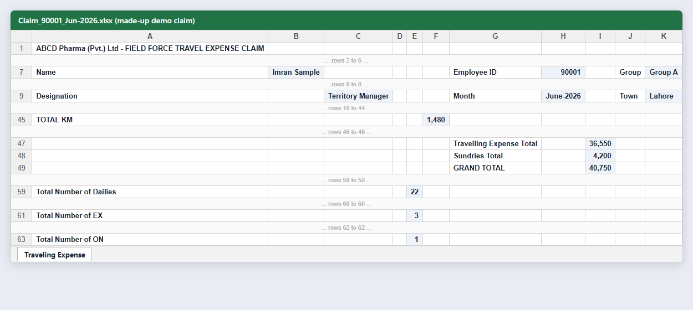
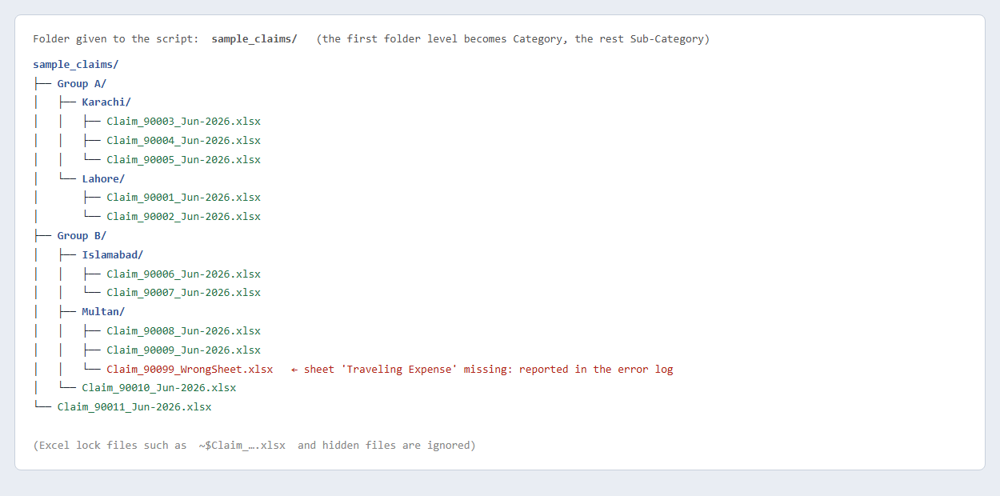
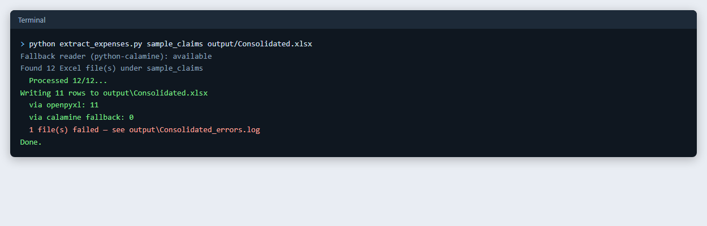
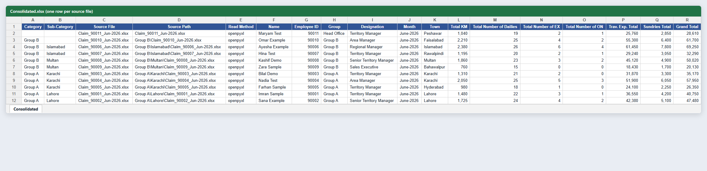
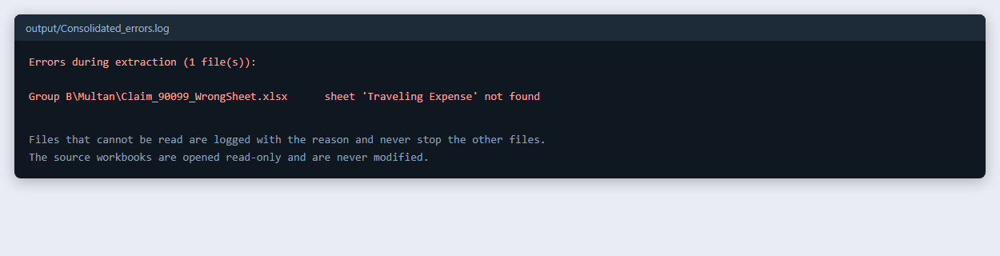

# Excel Expense Extractor

Pull the figures out of **hundreds of Excel claim forms** into **one consolidated workbook**: one row per file, no copy and paste.
The script walks a folder tree, reads fixed cells of each workbook (here a *Field Force Travel Expense Claim*), and writes a
single table with the folder names as **Category** and **Sub-Category**. Files that cannot be read are listed in an error log and never stop the run.











*All screenshots show made-up demo claims (a fictitious company, "ABCD Pharma"). They are rendered views of the real input and output files that the script produced, not Excel windows.*

## What it does

- Reads `.xlsx` and `.xlsm` files anywhere under a folder (sub-folders included). Excel lock files (`~$...`) and hidden files are skipped.
- Takes values from **fixed cell addresses** on one sheet (`FIELD_MAP` at the top of the script): name, employee ID, group, designation, month, town, total km, number of dailies / EX / ON, travelling total, sundries total and grand total.
- **Two readers:** `openpyxl` first; if it fails on malformed XML (files saved by mobile apps, WPS Office, LibreOffice or old Excel), the lenient `python-calamine` reader is tried. The *Read Method* column says which one worked.
- **Category / Sub-Category** come from the folder path: the first folder level is the Category and the rest is the Sub-Category.
- A file with a missing sheet (a different layout) is reported with the reason; it is not guessed.
- Source files are opened read-only and are **never modified**.

## Run it

```bash
pip install -r requirements.txt
python extract_expenses.py <root-input-folder> <output-xlsx-path>
```

Example with the bundled demo files:

```bash
python extract_expenses.py sample_claims output/Consolidated.xlsx
```

It writes `output/Consolidated.xlsx` and, if anything failed, `output/Consolidated_errors.log` next to it.

## Make your own demo files

```bash
python make_sample_claims.py sample_claims   # 11 made-up claims, one with a wrong sheet name, one lock file
```

## Adapt it to your own form

Edit `FIELD_MAP` in `extract_expenses.py`: each entry is `"Column title": ("Sheet name", "Cell address")`. The output columns follow the order of the map.

## Tests

```bash
python -m unittest discover -s tests -v    # 11 tests: address conversion, reading, the fallback reader, folder walking, error log, end to end
```

## Licence

MIT. See `LICENSE`.
